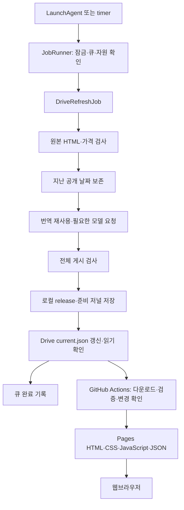

# 코드가 담당하는 일과 파일 위치

운영용 컴퓨터의 Python 워커는 원본 HTML에서 메뉴·가격을 읽어 번역과 함께 검사하고 Drive에 게시합니다. GitHub Actions 실행기는 Drive 공개 묶음을 내려받아 검증하고 화면과 JSON을 Pages에 배포합니다. 웹브라우저는 같은 Pages 사이트에서 화면과 데이터를 읽습니다. 웹 요청을 처리하는 Python 백엔드나 데이터베이스 엔진은 없습니다.

## 실행 위치와 설정

진입점 [`scripts/local_refresh.py`](../scripts/local_refresh.py)는 `--config PATH` 또는 `--base BASE`를 받습니다. `--base`도 `BASE/worker.toml`을 읽으며, 설정 누락을 이전 자동 Git 게시로 처리하지 않습니다. [`mensa/config.py`](../mensa/config.py)의 `load_worker_config`는 경로·모델·자원·게시 방식을 검사합니다. 설정을 읽는 것만으로 워커를 시작하거나 모델·Drive 연결을 확인하지 않습니다.

현재 Mac은 `~/mensa`의 코드를 사용하고, `~/Library/Application Support/Mensa`에 큐·체크포인트·모델·로그를 보관합니다. 기존 LaunchAgent는 같은 로그인 사용자로 `--base`를 호출합니다. Drive 준비 폴더는 예를 들어 `~/Library/Application Support/Mensa Data`처럼 코드·비공개 상태와 겹치지 않는 별도 경로입니다. 실제 전환 완료 여부는 [배포 확인](deployment.md)으로 판단합니다.

`--status`는 큐와 마지막 결과만 읽습니다. 실행 시 [`JobRunner`](../mensa/jobs.py)는 비공개 상태 폴더의 `worker.lock`에 OS 파일 잠금을 걸고 작업을 처리합니다. 다른 실행이 잠금을 갖고 있으면 큐와 결과를 바꾸지 않고 `busy`를 반환합니다. 성공한 수집 시각만 `queue.json`의 `completed_period`로 기록합니다. 재시도·연기·실패 상태는 `last-result.json`에도 기록합니다.

[`schedule.py`](../mensa/schedule.py)는 `Europe/Berlin` 기준 매일 09:00·10:00·11:00의 수집 시각을 계산합니다. [`queue.py`](../mensa/queue.py)는 대기 작업·중복 실행·실패 후 대기를 관리합니다. LaunchAgent와 Linux timer는 실행 기회를 제공하며 날짜 판단을 대신하지 않습니다.

## Drive 갱신과 복구

[`DriveRefreshJob`](../mensa/drive_refresh.py)은 `publication.mode = "drive"`를 처리합니다. 일상 실행은 코드 체크아웃을 읽기만 하며 Git·gh·GitHub Actions를 호출하지 않습니다. 새 수집은 현재 공개 Drive 묶음을 기준으로 교정과 이력을 보존합니다. 원격 묶음이 없는 최초 구성에서만 로컬 준비본을 대체 입력으로 사용할 수 있으며, 소스의 `site/data`를 자동 대체 입력으로 사용하지 않습니다.

식단 처리 순서를 맡는 [`RefreshService`](../mensa/refresh_service.py)는 새 원본의 구조·가격·현재 날짜 범위를 먼저 검사합니다. `retain_published_days`는 새 원본의 시작보다 앞선 기존 공개 날짜를 보존하고 같은 날짜는 새 값으로 교체합니다. 이어 지난 날짜까지 필요한 번역과 주의 표시를 완성하고 전체 게시 조건을 검사합니다. 구조가 유효한 메뉴 추가·삭제·교체·중복 수 변화와 빈 식단을 이전 항목 개수로 차단하지 않습니다. 날짜 연결·가격 출처·계속 존재하는 메뉴의 실제 가격 소실은 계속 검사합니다.

DriveRefreshJob은 검증한 날짜에서 지난 30일·오늘·원본의 미래 메뉴를 선택하고 필요한 번역만 공개합니다. [`retention.py`](../mensa/retention.py)는 기간·참조 집합·캐시 한도를 계산하고, [`retention_runtime.py`](../mensa/retention_runtime.py)는 비공개 번역과 사용 기록을 한 파일에 원자적으로 보관합니다. 새 원본에서 실제 사용한 항목만 수명을 갱신합니다. 검증된 공개 쌍은 [`DirectoryPublisher`](../mensa/releases.py)의 `data/releases/<release_id>/`에 준비하고 비공개 `drive-publication.json`에 이전 공개 릴리스·준비 ID·수집 시각·목적지를 기록합니다. 재시도 중 공개 교정이 생기면 최신 공개본에서 다시 준비합니다.

[`maintenance.py`](../mensa/maintenance.py)는 원격 읽기 확인 후 최근 성공본 10개와 현재·재시도 참조를 보호하며 오래된 등록 릴리스를 정리합니다. 성공 여부는 비공개 `retention-releases.json`에 기록하므로 로컬 포인터를 원격 성공으로 오인하지 않습니다. 유휴·실패 상태에도 JobRunner가 같은 잠금 아래 로그 한도와 생성 데이터 용량을 검사합니다. 미등록 자료·모델·소스·인증을 정리하지 않습니다.

[`DrivePublisher`](../mensa/drive_publication.py)는 rclone의 설정된 remote와 폴더 ID로 `current.json` 한 개만 읽고 갱신합니다. 파일 ID와 내용을 검사하고 업로드 후 다시 읽어 확인합니다. 같은 내용이면 업로드를 생략합니다. 이름이 중복되거나 설정과 파일 ID가 다르거나 기존 파일이 유효한 게시 묶음이 아니면 덮어쓰지 않습니다. 다른 파일의 삭제·동기화나 공유 설정 변경은 수행하지 않습니다.

업로드 결과나 완료 기록 저장을 확인하지 못하면 다음 시도는 저널이 가리키는 같은 로컬 묶음을 재사용합니다. 준비한 묶음이 현재 날짜에 유효하지 않으면 다시 수집합니다. 목적지 설정이 바뀌거나 이전 Git 게시 번호가 남은 대기 작업은 자동으로 버리지 않고 중단합니다. 네트워크 경합·전원 손실·Drive 동시 작성까지 원자적 복구를 보장하는 구조는 아니므로 같은 목적지에는 한 워커만 연결해 주세요.

## 번역과 모델

[`TranslationService`](../mensa/translation_service.py)는 검토 구문·완성된 번역·주의 표시 대응표를 먼저 사용합니다. [`translation_contract.py`](../mensa/translation_contract.py)는 원문 이름과 순서가 있는 구성품으로 번역 key를 만들고 표시값·출처·모델 버전·생성 정책을 검사합니다. 미등록 주의 표시도 캐시에서 찾거나 `kind:notice` 요청으로 번역한 뒤 게시합니다.

설정 기반 번역은 [`resume_configured_translations`](../mensa/translation_runtime.py)를 사용합니다. Drive는 `RetainedTranslationStore`를 연결하여 운영용 Mac의 `translation-state.json`에 완료한 번역과 사용 기록을 함께 저장합니다. 최초 이관 이후 옛 체크포인트를 다시 읽지 않아 만료 항목의 재유입을 막습니다. 일부 요리가 미완료일 수 있으므로 공개하지 않습니다. Mac 기본 경로는 기존 번역을 재사용하고 빠진 요리·주의 표시만 digest를 확인한 모델에 요청합니다. 이용자 브라우저에는 운영 캐시를 저장하지 않습니다.

새 번역이 필요할 때만 [`model_session`](../mensa/model_runtime.py)이 모델 연결을 준비합니다. `managed`는 설치된 Ollama를 별도 프로세스 그룹으로 시작하고 자신이 시작한 그룹만 종료합니다. `external`은 운영자가 준비한 endpoint를 사용합니다. 프로그램은 모델을 다운로드하지 않습니다. 요청 함수 [`request_translation`](../mensa/generation.py)은 완료 여부·응답 크기·두 언어·구성품 수와 잘못된 바이트 토큰 등을 검사하고 실패를 큐로 전달합니다.

## 브라우저의 읽기와 화면 상태

[`main.ts`](../frontend/main.ts)는 [`createDataClient(fetchPort)`](../frontend/data_client.ts)를 사용합니다. `loadManifest`는 같은 사이트의 `data/current.json`을 읽고 64자리 릴리스 ID를 검사합니다. `loadMenu`와 `loadTranslations`는 `data/releases/<ID>/`의 두 JSON을 독립적으로 읽고 검사합니다. 한 로드는 같은 ID를 사용합니다. 브라우저에 Drive 파일 ID·API 키를 전달하지 않습니다.

브라우저는 메뉴·번역의 SHA256을 다시 계산하지 않습니다. [`contracts.ts`](../frontend/contracts.ts)는 표시 스키마를 검사하고 [`display.ts`](../frontend/display.ts)는 번역과 독일어 원문 이름·구성품 순서가 맞는지 확인합니다. 번역이 실패하거나 원문이 다르면 유효한 독일어 메뉴를 유지합니다. 파일 요청과 JSON 읽기 제한은 15초입니다.

[`controller.ts`](../frontend/controller.ts)는 오래된 로드 결과가 새 메뉴나 번역 상태를 덮어쓰지 못하게 합니다. [`state.ts`](../frontend/state.ts)는 날짜·언어·가격 그룹과 독립된 메뉴/번역 요청 상태를 보관합니다. [`selectors.ts`](../frontend/selectors.ts)의 `visibleMeals`는 같은 날짜에서 ID 이외의 모든 내용이 같은 항목만 한 번 표시하며 원본 발생을 삭제하지 않습니다. 다른 날짜·위치·구성·주의 표시·가격의 메뉴는 유지합니다.

Pages 교체 직후 이전 릴리스 파일이 404를 반환하면 controller가 포인터를 한 번 다시 읽습니다. 게시본 ID가 바뀌었을 때만 두 요청 상태를 함께 초기화하고 새 ID의 메뉴·번역을 다시 읽습니다. 재시도는 한 번으로 제한하며 같은 ID·일반 통신 오류·번역 형식 오류는 반복 요청하지 않습니다. 이 재시도도 새 로드가 시작되면 화면 상태를 바꾸지 못합니다.

[`render.ts`](../frontend/render.ts), [`cards.ts`](../frontend/cards.ts), [`app.ts`](../frontend/app.ts)는 일간/주간·열린 상세·초점·보조기기 안내를 관리합니다. 언어·가격·번역 변경은 선택 날짜와 열린 상세를 유지합니다. 날짜·주·보기 변경은 화면에 남은 입력의 초점을 유지하며, 사라지는 주간 하루 보기 버튼의 초점만 날짜 선택창으로 옮깁니다. 별도 스크롤 이동은 하지 않습니다. 날짜와 최신성 판단은 Berlin 기준입니다.

## 화면 빌드와 호환 경로

[`build_site.py`](../scripts/build_site.py)는 이미 컴파일된 `main.js`에서 도달하는 정적 모듈만 내용별 해시 경로로 복사합니다. CSS도 내용별 경로를 사용합니다. `--drive-file-id`는 빌드 실행기가 API 키 없이 공개 JSON을 최대 16MiB·요청 60초로 내려받고 게시 계약·릴리스 해시·검토 사전을 검사합니다. `--data-dir`는 로컬 메뉴·번역을 읽습니다. 두 모드 모두 DirectoryPublisher 형식의 JSON과 화면을 새 출력 폴더에 만듭니다. 테스트 예제는 `tests/fixtures/menu-data`에 있습니다.

[`ci.yml`](../.github/workflows/ci.yml)은 코드 PR을 검사합니다. [`update-and-deploy.yml`](../.github/workflows/update-and-deploy.yml)은 main push·수동 요청·30분 간격 예약 실행으로 저장소 변수 `MENSA_DRIVE_FILE_ID`를 읽고 화면과 데이터를 Pages에 배포합니다. 예약 실행은 현재 Pages의 게시본 ID가 같으면 배포를 생략합니다. 워커가 Git·gh를 호출하거나 데이터 커밋·PR을 만들지는 않습니다. 실패한 다운로드·검증·빌드는 기존 Pages 배포를 교체하지 않습니다. 배포용 Actions 첨부파일의 보관 기간은 1일입니다.

DataClient는 배포물 안의 상대 JSON 경로만 사용합니다. 명시적인 `directory`·`github` WorkerConfig와 관련 코드는 기존 설치 호환용으로 남아 있습니다. 기존 Git 게시 큐·`snapshot-journal.json`·복구 참조는 전환 전에 정리 여부를 검토하고 보존합니다. 이 호환 경로는 Drive 설치의 일상 게시나 복구 절차가 아닙니다.

## 수정할 파일 찾기

| 수정 대상 | 시작할 파일 |
| --- | --- |
| 원본 페이지 추출 | [`scripts/menu_source.py`](../scripts/menu_source.py) |
| 메뉴·가격·날짜 보존 | [`mensa/menu_contract.py`](../mensa/menu_contract.py), [`refresh_service.py`](../mensa/refresh_service.py) |
| 번역 key·표현·재사용 | [`mensa/translation_contract.py`](../mensa/translation_contract.py) |
| 검토 문구 | [`data/editorial-translations.json`](../data/editorial-translations.json), [`notice-translations.json`](../data/notice-translations.json) |
| 전체 게시 검사 | [`mensa/publication.py`](../mensa/publication.py), [`notice_contract.py`](../mensa/notice_contract.py) |
| Drive 게시·재개 | [`mensa/drive_publication.py`](../mensa/drive_publication.py), [`drive_refresh.py`](../mensa/drive_refresh.py) |
| 최초 전환 설정 | [`scripts/configure_drive.py`](../scripts/configure_drive.py) |
| 설정·자원·큐 | [`mensa/config.py`](../mensa/config.py), [`resources.py`](../mensa/resources.py), [`jobs.py`](../mensa/jobs.py) |
| 데이터 요청·화면 | [`frontend/data_client.ts`](../frontend/data_client.ts), [`app.ts`](../frontend/app.ts) |
