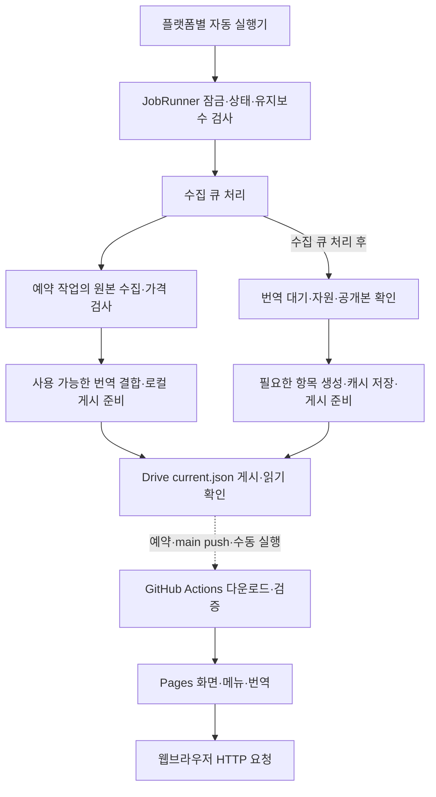

# 코드가 담당하는 일과 파일 위치

수집 호스트는 Python 수집기를 실행하는 컴퓨터 또는 서버입니다. 수집기는 원본 HTML에서 메뉴·가격을 읽고 사용할 수 있는 번역을 결합해 Google Drive에 게시합니다. GitHub Actions 배포 실행기는 이 공개 묶음을 검증한 뒤 화면 코드와 함께 GitHub Pages에 배포합니다. 웹브라우저는 Pages에서 HTML·JavaScript·JSON을 HTTP로 읽어 화면을 구성합니다.

## 실행 위치와 설정

공통 진입 명령은 `python3 -m scripts.local_refresh --config /path/to/worker.toml`입니다. `--base BASE`는 `BASE/worker.toml`을 선택하는 편의 옵션이며 Drive 모드에서는 같은 실행 경로를 사용합니다. `load_worker_config`는 설정 파일을 기준으로 경로·모델·자원·게시 방식을 읽고 검사합니다. [실행 진입점](../scripts/local_refresh.py), [설정 로더](../mensa/config.py)

자동 실행 등록과 자원 측정은 플랫폼별로 구성합니다. 제공된 자동 실행 도구는 macOS의 LaunchAgent와 Linux의 systemd 예제이며, 자원 측정은 설정의 `resources.platform`에 따라 `macos` 또는 `linux` 구현을 사용합니다. 수집·번역·게시 로직은 공통입니다. [설치 및 실행 절차](operations.md#새-환경에-설치할-때)

수집 호스트의 세 경로는 `worker.toml`로 정하며 서로 겹치지 않아야 합니다.

| 설정 | 역할 |
| --- | --- |
| `paths.checkout_dir` | 실행 코드와 검토용 번역 사전이 있는 체크아웃 |
| `paths.state_dir` | 수집 큐·번역 상태·재사용 캐시·게시 저널·잠금 등 비공개 작업 자료 |
| `paths.public_dir` | Drive 게시에 사용할 로컬 게시 준비 폴더와 보존 릴리스 |

모델 파일과 모델 로그의 위치는 `inference` 설정에서 따로 지정합니다. Drive와 Pages에는 공개 메뉴·번역을 게시하며, 비공개 재사용 캐시는 수집 호스트의 상태 디렉터리에 저장합니다. [데이터 계약](data-contract.md)

`--status`는 로컬 수집 큐·번역 작업 상태·마지막 결과를 조회합니다. 실제 실행에서는 `JobRunner`가 `worker.lock`의 OS 파일 잠금을 잡고 유지보수 검사, 수집 큐 처리, 번역 작업 판단을 차례로 수행합니다. 잠금이 이미 사용 중이면 `busy`를 반환합니다. 수집할 예약 슬롯이 없는 실행에서도 번역 작업은 재개할 수 있습니다. [작업 실행기](../mensa/jobs.py)

수집 일정은 `Europe/Berlin` 기준 매일 09:00·10:00·11:00입니다. 자동 실행기는 수집기를 호출할 기회를 제공하고, 큐가 실제로 처리할 예약 슬롯과 실패 후 대기를 결정합니다. `queue.json`의 `completed_period`는 완료한 예약 슬롯이고 `menu.source.fetched_at`은 실제 원본 수집 시각입니다. 번역 결과는 `translation-work.json`과 `last-result.json`의 `translations`에 별도로 기록합니다. [일정 계산](../mensa/schedule.py), [수집 큐](../mensa/queue.py)

## Drive 갱신과 복구

`DriveRefreshJob`은 `publication.mode = "drive"`를 처리합니다. 새 수집은 현재 공개 Drive 묶음을 기준으로 교정과 이력을 보존하고, 원격 묶음이 없는 최초 구성에서는 로컬 준비본을 사용할 수 있습니다. 일상 데이터 갱신의 저장 대상은 로컬 상태·준비 폴더와 Drive의 `current.json`입니다. [Drive 수집 작업](../mensa/drive_refresh.py)

식단 처리 순서를 맡는 [`RefreshService`](../mensa/refresh_service.py)는 새 원본의 구조·가격·현재 날짜 범위를 먼저 검사합니다. `retain_published_days`는 새 원본의 시작보다 앞선 기존 공개 날짜를 보존하고 같은 날짜는 새 값으로 교체합니다. 이어 사전·캐시의 사용할 수 있는 번역을 적용하고 모델 없이 게시합니다. 구조가 유효한 메뉴 추가·삭제·교체·중복 수 변화와 빈 식단을 이전 항목 개수로 차단하지 않습니다. 날짜 연결·가격 출처·가격표 추출은 계속 검사하며 현재 원본의 실제 가격 미기재는 `source_pending`으로 게시합니다.

DriveRefreshJob은 검증한 날짜에서 지난 30일·오늘·원본의 미래 메뉴를 선택하고 필요한 번역만 공개합니다. [`retention.py`](../mensa/retention.py)는 기간·참조 집합·캐시 한도를 계산하고, [`retention_runtime.py`](../mensa/retention_runtime.py)는 비공개 번역과 사용 기록을 한 파일에 원자적으로 보관합니다. 새 원본에서 실제 사용한 항목만 수명을 갱신합니다. 검증된 공개 쌍은 [`DirectoryPublisher`](../mensa/releases.py)의 `data/releases/<release_id>/`에 준비하고 비공개 `drive-publication.json`에 이전 공개 릴리스·준비 ID·수집 예약 슬롯·목적지를 기록합니다. 재시도 중 공개 교정이 생기면 최신 공개본에서 다시 준비합니다.

`maintenance.py`는 원격 읽기 확인 후 성공 여부를 `retention-releases.json`에 기록하고 보관 한도를 적용합니다. 기본 정책은 최근 성공본 10개와 현재·재시도 참조를 보호합니다. 유휴·실패 상태에도 같은 잠금 아래 알려진 로그와 생성 자료의 용량을 검사합니다. [정리 구현](../mensa/maintenance.py), [보관 정책](operations.md#데이터-보관-한도와-정리)

저장된 백업·릴리스의 소유권은 inode·권한과 파일의 크기·수정 시각·링크 수·내용 해시로 대조합니다. 재부팅·재마운트 때 바뀔 수 있는 장치 번호 `st_dev`는 이 영구 기록 비교에서 제외합니다. 정리 계획에는 현재 장치 번호도 포함하며 적용 전과 삭제 직전에 다시 대조합니다. 이 구분으로 기존 기록을 그대로 읽으면서 실행 중 경로·파일 교체를 검사합니다. [소유권 비교와 정리 적용](../mensa/maintenance.py)

[`DrivePublisher`](../mensa/drive_publication.py)는 rclone의 설정된 remote와 폴더 ID로 `current.json` 한 개만 읽고 갱신합니다. 파일 ID와 내용을 검사하고 업로드 후 다시 읽어 확인합니다. 같은 내용이면 업로드를 생략합니다. 이름이 중복되거나 설정과 파일 ID가 다르거나 기존 파일이 유효한 게시 묶음이 아니면 덮어쓰지 않습니다. 다른 파일의 삭제·동기화나 공유 설정 변경은 수행하지 않습니다.

업로드 결과나 완료 기록 저장을 확인하지 못하면 다음 시도는 저널이 가리키는 같은 로컬 묶음을 재사용합니다. 준비한 묶음이 현재 날짜에 유효하지 않으면 다시 수집합니다. 목적지 설정이 바뀌거나 이전 Git 게시 번호가 남은 대기 작업은 자동으로 버리지 않고 중단합니다. 네트워크 경합·전원 손실·Drive 동시 작성까지 원자적 복구를 보장하는 구조는 아니므로 같은 목적지에는 한 워커만 연결해 주세요.

## 번역과 모델

[`TranslationService`](../mensa/translation_service.py)는 검토 구문·완성된 번역·주의 표시 대응표를 먼저 사용합니다. [`translation_contract.py`](../mensa/translation_contract.py)는 원문 이름과 순서가 있는 구성품으로 번역 key를 만들고 표시값·출처·모델 버전·생성 정책을 검사합니다. 미등록 주의 표시도 캐시에서 찾거나 `kind:notice` 요청으로 번역한 뒤 게시합니다.

설정 기반 번역은 `resume_configured_translations`를 사용합니다. Drive 실행은 `RetainedTranslationStore`를 연결하여 수집 호스트의 `translation-state.json`에 완료한 번역과 사용 기록을 함께 저장합니다. 옛 체크포인트는 최초 이관 때 읽습니다. 번역 작업은 최신 공개 메뉴를 기준으로 필요한 요리·주의 표시를 생성하고, 같은 메뉴와 개선된 번역을 새 릴리스로 게시합니다. 작업 중 공개본이 바뀌면 최신 공개본과 유효한 캐시를 기준으로 다시 준비합니다. [번역 실행](../mensa/translation_runtime.py), [재사용 캐시](../mensa/retention_runtime.py), [번역 게시 복구](../mensa/translation_work.py)

`recover_cache`는 기존 캐시의 잘못된 개별 항목만 제외합니다. 게시 검사는 특정 번역 문장의 동일성을 요구하지 않습니다. 새 응답이 구조를 지키지 않으면 해당 항목을 미완성으로 남기고 다음 항목으로 진행합니다. 공개 쌍의 원래 해시와 원본 메뉴 검증은 복구 전에도 유지합니다. 브라우저의 `recoverTranslations`도 손상된 개별 번역을 제외하여 정상 번역과 독일어 메뉴를 유지합니다.

새 번역이 필요하고 자원 조건을 충족하면 `model_session`이 모델 연결을 준비합니다. `managed`는 미리 설치한 Ollama를 별도 프로세스 그룹으로 시작하고 해당 그룹을 종료합니다. `external`은 운영자가 준비한 endpoint를 사용합니다. 요청 함수 `request_translation`은 완료 여부·응답 크기·두 언어·구성품 수와 바이트 토큰을 검사합니다. 번역 작업의 실패 종류에 따라 개별 항목을 보완하거나 대기 후 재시도하며, 인증·설정 문제는 운영자의 조치가 필요합니다. [모델 실행](../mensa/model_runtime.py), [생성 요청](../mensa/generation.py), [번역 상태](../mensa/translation_work.py)

## 브라우저의 읽기와 화면 상태

[`main.ts`](../frontend/main.ts)는 [`createDataClient(fetchPort)`](../frontend/data_client.ts)를 사용합니다. `loadManifest`는 같은 사이트의 `data/current.json`을 읽고 64자리 릴리스 ID를 검사합니다. `loadMenu`와 `loadTranslations`는 `data/releases/<ID>/`의 두 JSON을 독립적으로 읽고 검사합니다. 한 로드는 같은 ID를 사용합니다. 브라우저에 Drive 파일 ID·API 키를 전달하지 않습니다.

브라우저는 메뉴·번역의 SHA256을 다시 계산하지 않습니다. [`contracts.ts`](../frontend/contracts.ts)는 표시 스키마를 검사하고 [`display.ts`](../frontend/display.ts)는 번역과 독일어 원문 이름·구성품 순서가 맞는지 확인합니다. 번역이 실패하거나 원문이 다르면 유효한 독일어 메뉴를 유지합니다. 파일 요청과 JSON 읽기 제한은 15초입니다.

[`controller.ts`](../frontend/controller.ts)는 오래된 로드 결과가 새 메뉴나 번역 상태를 덮어쓰지 못하게 합니다. [`state.ts`](../frontend/state.ts)는 날짜·언어·가격 그룹과 독립된 메뉴/번역 요청 상태를 보관합니다. [`selectors.ts`](../frontend/selectors.ts)의 `visibleMeals`는 같은 날짜에서 ID 이외의 모든 내용이 같은 항목만 한 번 표시하며 원본 발생을 삭제하지 않습니다. 다른 날짜·위치·구성·주의 표시·가격의 메뉴는 유지합니다.

Pages 교체 직후 이전 릴리스 파일이 404를 반환하면 controller가 포인터를 한 번 다시 읽습니다. 게시본 ID가 바뀌었을 때만 두 요청 상태를 함께 초기화하고 새 ID의 메뉴·번역을 다시 읽습니다. 재시도는 한 번으로 제한하며 같은 ID·일반 통신 오류·번역 형식 오류는 반복 요청하지 않습니다. 이 재시도도 새 로드가 시작되면 화면 상태를 바꾸지 못합니다.

`render.ts`, `cards.ts`, `app.ts`는 일간/주간·열린 상세·초점·보조기기 안내를 관리합니다. 언어·가격·번역 변경은 선택 날짜와 열린 상세를 유지합니다. 날짜·주·보기 변경은 화면에 남은 입력의 초점을 유지하며, 사라지는 주간 하루 보기 버튼의 초점은 날짜 선택창으로 옮깁니다. [화면 렌더링](../frontend/render.ts), [카드](../frontend/cards.ts), [앱](../frontend/app.ts)

오늘의 날짜와 메뉴 선택은 `Europe/Berlin`을 기준으로 계산합니다. 오래된 수집 경고는 현재 시각과 `source.fetched_at`의 차이가 48시간을 초과할 때 표시합니다. 모든 식단이 지난 날짜인 경우와 지난 날짜를 선택한 경우에는 각각 다른 안내를 표시합니다. 페이지를 새로 읽으면 현재 Pages 포인터의 게시본을 가져옵니다. [날짜·최신성 판정](../frontend/selectors.ts), [수집 지연 조사](operations.md#실패-확인과-재시도)

## 화면 빌드와 호환 경로

`build_site.py`는 이미 컴파일된 `main.js`에서 도달하는 정적 모듈을 내용별 해시 경로로 복사합니다. CSS도 내용별 경로를 사용합니다. `--drive-file-id`는 공개 Drive JSON을 최대 16MiB·요청 60초로 읽고 게시 계약·릴리스 해시·용어집 구조를 검사합니다. `--data-dir`는 로컬 메뉴·번역을 읽습니다. 두 모드 모두 DirectoryPublisher 형식의 JSON과 화면을 새 출력 폴더에 만듭니다. 빌더는 `today=None`으로 형식을 검사하므로 원본 수집 시각과 날짜 범위는 별도로 확인합니다. 테스트 예제는 `tests/fixtures/menu-data`에 있습니다. [사이트 빌더](../scripts/build_site.py)

CI는 PR과 main 변경을 검사합니다. Pages 워크플로는 main push·수동 요청·매시 17분과 47분의 예약으로 실행하며, `MENSA_DRIVE_FILE_ID`에 지정한 공개 데이터를 사용합니다. 예약 실행에서는 Pages의 현재 포인터와 새 빌드의 포인터를 비교합니다. 두 포인터가 다르거나 현재 포인터를 읽지 못하면 새 배포물을 게시합니다. 데이터는 Actions 배포물로 전달되고 데이터 갱신만으로 Git 커밋·PR을 만들지 않습니다. 실제 웹페이지 반영은 워크플로 실행과 배포가 완료된 시점에 결정됩니다. 배포용 Actions 첨부파일의 보관 기간은 1일입니다. [CI](../.github/workflows/ci.yml), [Pages 배포](../.github/workflows/update-and-deploy.yml)

DataClient는 배포물 안의 상대 JSON 경로만 사용합니다. 명시적인 `directory`·`github` WorkerConfig와 관련 코드는 기존 설치 호환용으로 남아 있습니다. 기존 Git 게시 큐·`snapshot-journal.json`·복구 참조는 전환 전에 정리 여부를 검토하고 보존합니다. 이 호환 경로는 Drive 설치의 일상 게시나 복구 절차가 아닙니다.

## 수정할 파일 찾기

| 수정 대상 | 시작할 파일 |
| --- | --- |
| 원본 페이지 추출 | [`scripts/menu_source.py`](../scripts/menu_source.py) |
| 메뉴·가격·날짜 보존 | [`mensa/menu_contract.py`](../mensa/menu_contract.py), [`refresh_service.py`](../mensa/refresh_service.py) |
| 번역 key·표현·재사용 | [`mensa/translation_contract.py`](../mensa/translation_contract.py) |
| 검토 문구 | [`data/editorial-translations.json`](../data/editorial-translations.json), [`notice-translations.json`](../data/notice-translations.json) |
| 전체 게시 검사 | [`mensa/publication.py`](../mensa/publication.py), [`notice_contract.py`](../mensa/notice_contract.py) |
| Drive 게시·재개 | [`mensa/drive_publication.py`](../mensa/drive_publication.py), [`drive_refresh.py`](../mensa/drive_refresh.py) |
| 최초 전환 설정 | [`scripts/configure_drive.py`](../scripts/configure_drive.py) |
| 설정·자원·큐 | [`mensa/config.py`](../mensa/config.py), [`resources.py`](../mensa/resources.py), [`jobs.py`](../mensa/jobs.py) |
| 데이터 요청·화면 | [`frontend/data_client.ts`](../frontend/data_client.ts), [`app.ts`](../frontend/app.ts) |
